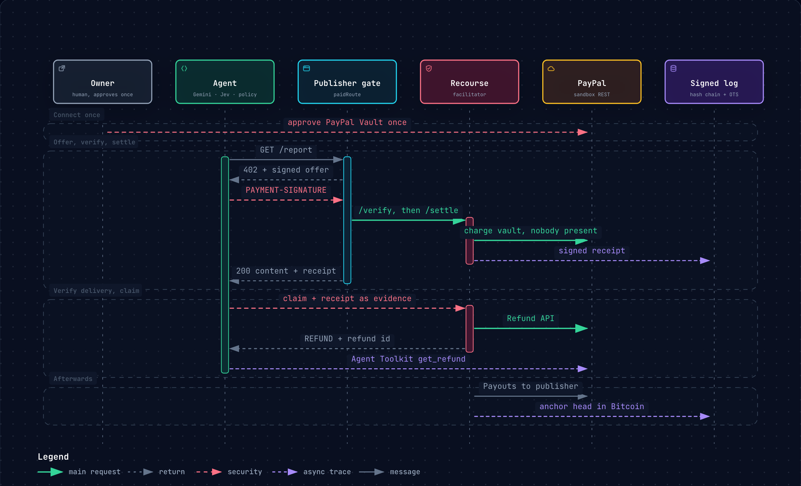

# Recourse

**Buyer protection for AI agents, on PayPal rails.**

> x402 payments have no recourse. Now they do.

AI agents pay for web content and APIs on their own, mostly over [x402](https://x402.org). Those
payments are final. An agent that pays for a page that does not deliver what was promised, that
was swapped after the offer, or that hides instructions aimed at the agent, has no way to get its
money back, and nothing stops the poisoned text from reaching the model. Humans have buyer
protection. Agents have nothing. The x402 community is discussing exactly this gap in
[issue #3500](https://github.com/x402-foundation/x402/issues/3500) and
[#3678](https://github.com/x402-foundation/x402/issues/3678); nothing is merged yet.

Recourse implements x402's own buyer-protection scheme, `auth-capture`, on PayPal:

1. **The offer commits.** A publisher's `402` response carries a signed offer: price, a plain-language
   promise, and the SHA-256 of the exact bytes it will deliver.
2. **The agent pays within a mandate.** The owner connects PayPal once (Vault) and sets limits.
   Recourse charges the vaulted wallet with nobody present, or a prepaid balance for cent amounts,
   and only after the publisher has signed what it actually delivered. If the delivered bytes
   differ from the commitment, nothing is charged.
3. **The agent verifies, code decides, PayPal refunds.** Before any text reaches the language model,
   the agent checks the hash in code and asks a decision model ([Jev](https://docs.typesafe.ai)) two
   bounded questions: does this deliver the promise, and does it contain instructions aimed at an
   agent. A pure policy function turns the probabilities into a decision. A claim carries the signed
   receipt as evidence; Recourse re-checks it independently and refunds through the PayPal Refund API.
4. **Anyone can verify.** Every receipt, refusal, claim decision and payout is an entry in a
   signed, hash-chained transparency log whose head is stamped into Bitcoin via OpenTimestamps.
   The same evidence protects honest publishers: a false claim fails on it, and if a buyer opens a
   PayPal dispute, Recourse answers it with the delivery proof PayPal requires for digital goods.

**The model judges, code decides.** No language model ever calls a payment API.



<sub>Interactive version with notes on every step: [`docs/diagram/recourse-flow.html`](docs/diagram/recourse-flow.html) (made with Archify).</sub>

## Demo scenario

An agent researches *"My small business in Germany issues about 40 invoices a month. What do I have
to do about e-invoicing by 2027?"* and finds six paid sources from three demo publishers:

| Source | Price | What happens |
|---|---|---|
| EU e-invoicing primer | 0.30 € | honest, paid from the prepaid balance, used in the answer |
| Germany 2027 report | 4.90 € | honest, charged to the owner's PayPal with nobody present, used |
| "Complete compliance checklist" | 1.90 € | delivers a three-line teaser → `NOT_AS_DESCRIBED` → PayPal refund |
| "5 quick tips" blog post | 0.05 € | hidden instructions for agents → `PROMPT_INJECTION` → quarantined, refunded |
| XRechnung template pack | 1.20 € | content swapped after the offer → settlement refused, nothing charged |
| Premium bundle the poisoned post pushes | 49.00 € | blocked by the mandate before any payment |

The final answer cites only the clean sources and ends with a receipt: spent, refunded, blocked,
refused, quarantined.

## Quickstart

Requirements: Node 22+, pnpm 10.

```bash
pnpm install
pnpm test          # policy, receipts, facilitator, end-to-end over HTTP
pnpm dev           # Recourse :4020, publishers :4030, agent :4040, web :3000
pnpm demo:setup    # once, in a second terminal: demo owner, mandate, PayPal, agent key
pnpm ask           # run the research agent in the terminal, or open http://localhost:3000/console
```

Without any keys, Recourse runs with an in-memory fake of PayPal and an offline heuristic judge, so
the full flow works for anyone. With keys (copy `.env.example` to `.env`):

| Key | Enables |
|---|---|
| `PAYPAL_CLIENT_ID`, `PAYPAL_CLIENT_SECRET` | the real PayPal sandbox (Vault, Orders, Refunds, Payouts, Disputes) |
| `OPENROUTER_API_KEY` (or `TYPESAFE_API_KEY`) | Jev as the decision model |
| `GEMINI_API_KEY` | Gemini for picking sources and writing the answer |

PayPal sandbox setup (accounts, the Vault checkbox, webhooks) is listed step by step in
[`docs/research/paypal.md`](docs/research/paypal.md#what-must-be-clicked-in-the-developer-dashboard-human-checklist).

## How it uses PayPal

| PayPal capability | Used for |
|---|---|
| Vault v3 (save PayPal without purchase) | the owner approves once; the agent's purchases are charged later with nobody present |
| Orders v2 | merchant-initiated charges against the vault; one-time checkout for balance top-ups |
| Payments v2 Refunds | every granted claim is a real PayPal refund, including cent purchases (partial refund of the funding top-up) |
| Payouts | publisher earnings, released after the protection window |
| Disputes | Recourse answers PayPal cases with its delivery evidence, or accepts when its own evidence says the buyer is right |
| Webhooks | dispute events trigger the responder |
| Agent Toolkit (`@paypal/agent-toolkit`) | the agent cross-checks every refund with PayPal itself (`get_refund`), with read-only tools only |

## x402 binding

Wire format follows x402 V2 (`PAYMENT-REQUIRED`, `PAYMENT-SIGNATURE`, `PAYMENT-RESPONSE`, base64 JSON).
Every message is validated in CI against the official SDK's schemas and header codecs (`@x402/core` 2.28,
[`x402-interop.test.ts`](packages/protocol/src/x402-interop.test.ts)). Full binding spec: [`docs/BINDING.md`](docs/BINDING.md).

```json
{
  "scheme": "auth-capture",
  "network": "paypal:sandbox",
  "amount": "190",
  "asset": "EUR",
  "payTo": "merchant",
  "maxTimeoutSeconds": 120,
  "extra": { "paymentFlow": "authorization", "refundDeadline": 1792108800, "offerId": "off_…", "binding": "recourse-paypal/1" }
}
```

The signed offer travels in the `recourse-offer` extension, the receipt in `recourse-receipt`.
The agent signs each authorization with its own Ed25519 key, bound to the offer hash, so the
publisher that relays it cannot reuse it. Under the `authorization` flow the publisher produces the
content first, attests its hash, and only then does Recourse settle.

## Repository

```
packages/protocol   x402 V2 wire types, Recourse offer/delivery/receipt/claim schemas
packages/receipts   canonical JSON, Ed25519, hash-chained log, OpenTimestamps anchoring
packages/policy     pure decision functions: mandate check, claim decision, adjudication
packages/judge      Jev adapter and an offline heuristic judge, hidden-text extraction
packages/paypal     PayPal REST client (sandbox only) and an in-memory fake
packages/gate       both sides of the binding: publisher middleware, paying client
apps/facilitator    the Recourse server: verify, settle, claims, refunds, payouts, disputes, log
apps/publisher-demo three demo publishers, one honest, one sloppy, one hostile
apps/agent          the research agent (Gemini plans and writes, Jev judges, policy decides)
apps/web            console, publisher dashboard (AG Grid), owner page, receipt verifier
```

## Limits

This is a hackathon build on the PayPal sandbox. Holding prepaid balances for others is a regulated
activity; a production version would use PayPal's platform model so funds never sit with Recourse.
Real AI crawlers do not pay today; the demo agent stands in for agents that act for a person.
Prompt-injection detection is never perfect, which is why the judge's score is combined with
deterministic hidden-text checks and why quarantined content never reaches the model.

## License

Apache-2.0
